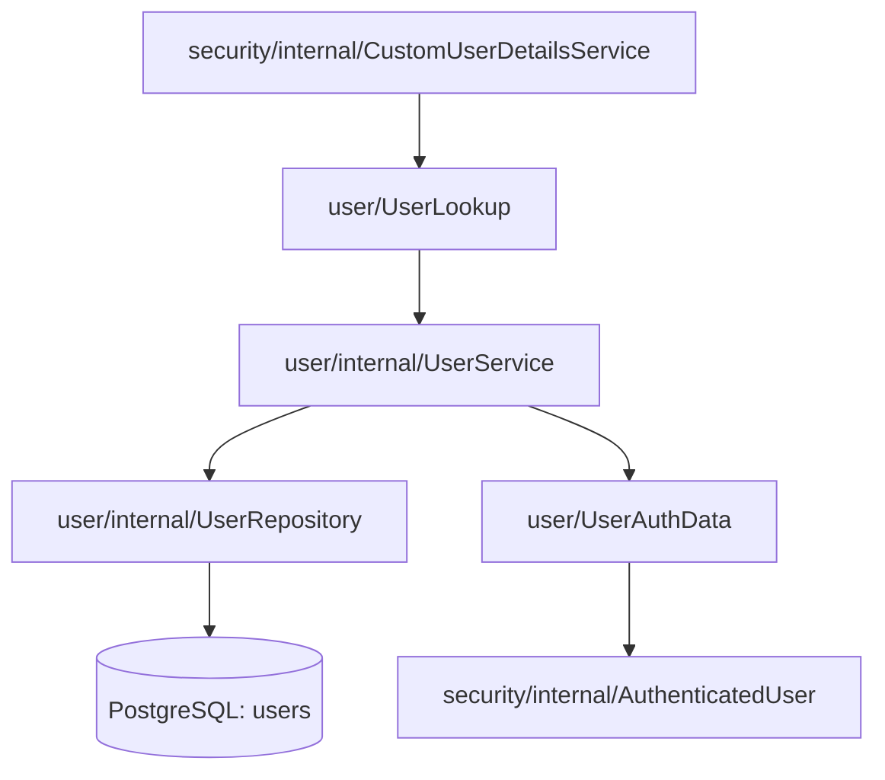

# Módulo `user`

**Status:** implementação desenvolvida na branch `feat/auth`, sujeita à revisão da PR.  
**Package:** `io.github.inaciofragalli.rivet.user`  
**Contexto:** autenticação administrativa do MVP; inicialmente apenas um administrador.

## Responsabilidade

O módulo `user` mantém a identidade e os dados persistidos dos usuários que podem acessar o painel Rivet. Também expõe contratos mínimos para consulta de credenciais e provisionamento inicial, sem depender diretamente do Spring Security.

Não há cadastro público, recuperação de senha, multi-tenancy ou gerenciamento de papéis nesta etapa. O módulo **não cria sessões, não recebe requisições de login e não valida passwords**: essas responsabilidades pertencem a `security`.

## Organização

```text
user/
├── UserAuthData.java
├── UserLookup.java
├── UserProvisioning.java
└── internal/
    ├── User.java
    ├── UserRepository.java
    └── UserService.java
```

`User` e `UserRepository` são internos. O módulo `security` consome apenas interfaces e tipos públicos: `UserLookup`, `UserProvisioning` e `UserAuthData`. Assim, `security` não depende da entidade JPA nem do repository de `user`, preservando os limites do Spring Modulith.

## Persistência

A migração Flyway `V6__create_users.sql`, adicionada durante `feat/auth`, define:

| Coluna | Tipo | Regra |
| --- | --- | --- |
| `id` | `UUID` | Chave primária |
| `email` | `VARCHAR(254)` | Obrigatório, único (`uk_users_email`) |
| `password_hash` | `VARCHAR(255)` | Obrigatório; armazena hash, não senha bruta |
| `created_at` | `TIMESTAMPTZ` | Obrigatório, com `DEFAULT CURRENT_TIMESTAMP` |

A geração do UUID é responsabilidade do mapeamento JPA. O Hibernate valida o esquema com `spring.jpa.hibernate.ddl-auto=validate`; alterações futuras devem usar migrações novas, sem reescrever a V6 após aplicada.

## API pública entre módulos

### `UserLookup`

```java
Optional<UserAuthData> findByEmail(String email);
```

O método permite ao adaptador de autenticação localizar um usuário pelo email sem obter uma entidade JPA externa. `UserService` consulta `UserRepository.findByEmail(email)`, cujo resultado é `Optional<User>`, e transforma o valor em `UserAuthData`.

### `UserAuthData`

`record` com `UUID id`, `String email` e `String passwordHash`. É um contrato **interno ao backend e público somente entre módulos**; nunca deve ser serializado como resposta HTTP, logado ou exposto em endpoint de consulta.

### `UserProvisioning`

Operações desenhadas para criar o administrador inicial:

```java
boolean hasUsers();
void createInitialAdmin(String email, String passwordHash);
```

O serviço persiste um novo usuário **somente quando a tabela está vazia**. A senha deve chegar ao método já codificada por `PasswordEncoder`, utilizado em `security`. O método de provisionamento não recebe senha em texto puro.

Essa interface não autoriza cadastro público nem deve ser transformada em endpoint sem um novo desenho de autorização.

## Provisionamento inicial

`security/internal/InitialAdminProvisioner` usa `UserProvisioning` para saber se a tabela contém usuários. Na primeira inicialização de um banco vazio, lê credenciais externas, gera o hash via `PasswordEncoder` e chama `createInitialAdmin`. Em inicializações seguintes, o administrador já existente permanece inalterado. Se o banco estiver vazio e faltarem as credenciais, o boot falha com erro de configuração, em vez de iniciar sem administrador.

A implementação inicial utiliza verificação de ausência de usuários seguida de inserção. **`@Transactional` sozinho não garante atomicidade frente a duas inicializações concorrentes**: antes da exposição do painel, a revisão de segurança deverá definir proteção efetiva contra múltiplos bootstraps simultâneos, com comportamento idempotente verificável.

## Integração com `security`



O `AuthenticatedUser` implementa `UserDetails` a partir do DTO, sem manter referência a `User`. Não há relação entre a entidade `User` e o usuário SSH cadastrado no módulo `server`.

## Segurança e limitações

- Senhas nunca são armazenadas em texto puro; somente hashes produzidos pelo `PasswordEncoder` configurado.
- O banco possui unicidade de email; validação e normalização do email devem ser conferidas na implementação efetiva antes do release.
- Não há roles persistidas na V6. Nesta fase, autorização é baseada em **estar autenticado**, não em múltiplos níveis de permissão.
- A verificação prévia `hasUsers()` não é trava de concorrência.
- `UserAuthData` contém o hash da senha: não é DTO de resposta da API.
- O fluxo de criação inicial pode ser acionado somente pelo bootstrap controlado, nunca por rota pública.

## Testes e validação

A branch `feat/auth` incluiu testes de provisionamento e integração de autenticação, com PostgreSQL via Testcontainers. O último resultado **relatado** foi de 117 testes aprovados no total, incluindo a verificação de modularidade. Não houve inspeção direta das classes locais nem reprodução desta execução durante esta edição documental.

Os comportamentos de bootstrap com banco vazio, ausência de variáveis, restart e concorrência devem permanecer cobertos na revisão final. Consulte também o [guia de autenticação](../../guides/authentication.md).
