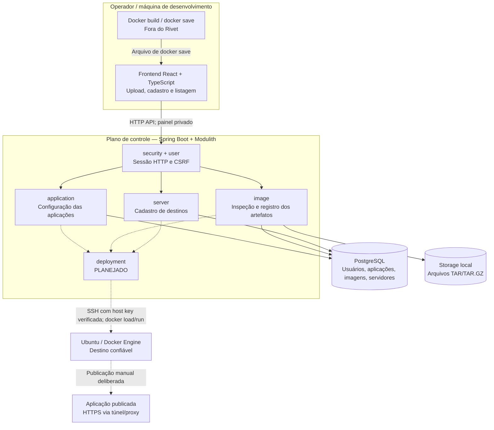
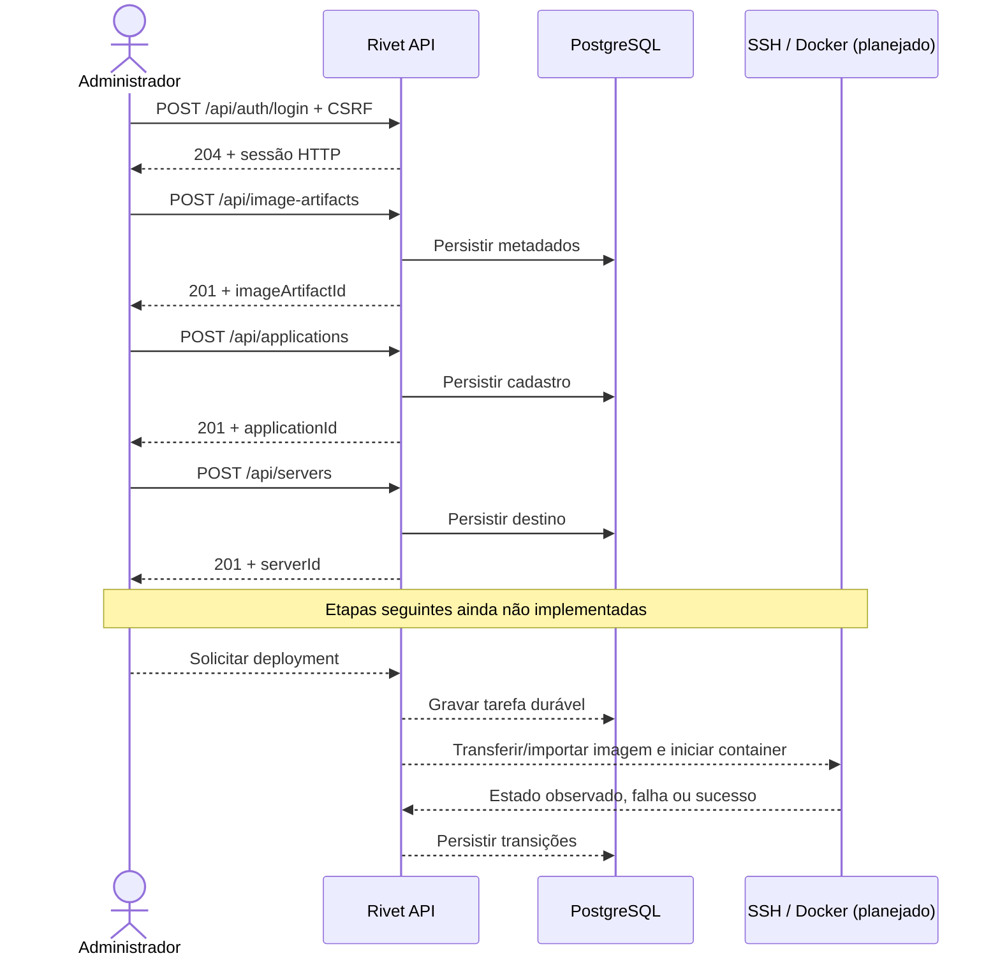

# Visão de arquitetura do Rivet

**Estado:** base de cadastros e autenticação desenvolvida; implantação remota ainda planejada.  
**Referência:** especificação técnica Rivet v0.5, de 13/10/2026, e desenvolvimento subsequente na `feat/auth`.

## Objetivo

O Rivet é um **plano de controle self-hosted** para gerenciar aplicações conteinerizadas em máquinas próprias. O controle administrativo ficará privado; apenas as aplicações explicitamente publicadas deverão receber URLs externas. O objetivo inicial é ser útil com um único administrador e um nó Ubuntu modesto, separando build de deployment.

## Componentes e estado de implementação

**Legenda:** setas contínuas representam responsabilidades e fluxos existentes ou de entrada; setas tracejadas representam relações e operações ainda previstas para o módulo `deployment` e a publicação externa. O diagrama é lógico e **não** demonstra conexão SSH ou execução Docker implementadas.

## Fronteiras dos módulos

| Módulo | Responsabilidade | Estado nesta fase |
| --- | --- | --- |
| `application` | Cadastro/consulta de aplicações e vínculo com artefatos | Implementado |
| `image` | Upload de TAR/TAR.GZ de `docker save`, inspeção e storage | Implementado; sem `docker load` |
| `server` | Registro/consulta de host, porta e usuário SSH | Implementado; sem conexão SSH |
| `user` | Persistência de usuários e contratos de provisionamento/consulta | Implementado em `feat/auth`; revisão pendente |
| `security` | Login por sessão HTTP, CSRF, autorização e logout | Implementado em `feat/auth`; revisão pendente |
| `deployment` | Tarefas persistidas, SSH/Docker, transições e resultados | Planejado |
| `domains`, `builds`, `monitoring`, `integrations` | Recursos adicionais de publicação, build e operação | Futuros |

O Spring Modulith organiza as capacidades por pacotes. A raiz de cada módulo contém tipos expostos a outros módulos, enquanto `internal/` mantém entidades JPA, controllers, repositórios e adaptadores. Integrações respeitam os contratos públicos, e `RivetModularityTests` verifica limites com `ApplicationModules.verify()`.

## Fluxo do MVP

O upload e o cadastro estão implementados; a execução remota ainda não. Mesmo depois de implementada, um registro em banco não deve ser confundido com estado observado em tempo real no Docker.

## Topologia e confiança

- **Desenvolvimento:** o backend pode rodar no computador principal e administrar o Dell por SSH quando o executor existir.
- **MVP de hospedagem:** o controlador poderá futuramente rodar em stack Docker Compose própria no Dell Ubuntu Server 24.04, sem depender de si mesmo para ser atualizado.
- **Administração:** disponível apenas por Tailscale ou rede privada autenticada equivalente. Exigir autenticação/CSRF e HTTPS no acesso real.
- **Aplicações externas:** Cloudflare Tunnel/domínios configurados manualmente no MVP; administração e execução Docker não ficam expostas publicamente.
- **SSH/Docker:** acesso SSH por chave, host key verificada, operações permitidas e parâmetros estruturados; não oferecer shell arbitrário ou socket Docker via TCP.

## Decisões relacionadas

- [ADR 0001](../adr/0001-modulith-jpa.md): adiar event publication via JPA.
- [ADR 0002](../adr/0002-admin-session-auth.md): autenticação por sessão HTTP.
- [ADR 0003](../adr/0003-separate-build-and-deploy.md): separação entre build, entrega e deployment.

## Limites atuais

O backend não fornece ainda `deployment`, runtime remoto, logs Docker, health real ou reinício de contêineres. O frontend ainda não oferece fluxo final de autenticação, servidores e deploy. O código da `feat/auth` passou por testes relatados, mas aguarda revisão de segurança da PR. Não assumir que a aplicação esteja pronta para exposição por causa da existência de login.
